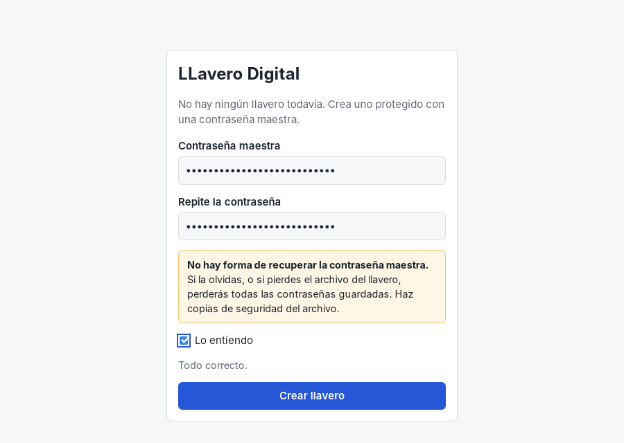
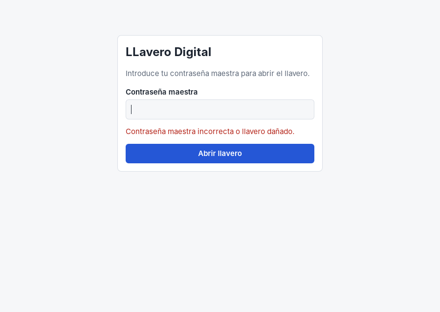
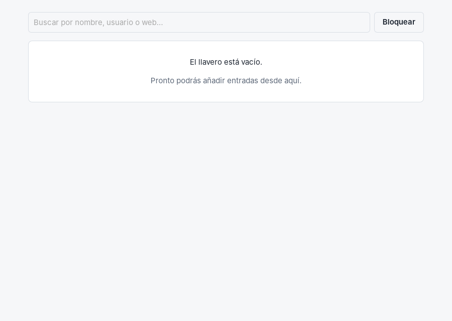

# 0008 — Primera versión de la app de escritorio (Tauri 2 + Svelte 5)

- **Fecha:** 2026-11-24
- **Fase:** 1
- **Commits:** commit «app: Tauri 2 + Svelte 5 desktop app (create/unlock, list, search, lock)» (PR hacia `main`)

## Resumen
Ya existe la app de escritorio. Permite crear el llavero o abrirlo con la contraseña maestra, ver y buscar las entradas, y bloquearlo. Toda la lógica es la del `core`; la app solo la conecta con la interfaz. Se ha diseñado para exponer lo mínimo: permisos explícitos para cada comando, ningún plugin de Tauri, una política de seguridad de contenido (CSP) estricta y ninguna contraseña enviada a la interfaz.

| Crear llavero | Contraseña incorrecta | Llavero abierto |
|---|---|---|
|  |  |  |

*Capturas de la app compilada en modo producción (Linux, pantalla virtual), con datos de prueba.*

## Cambios

**Rust (`app/src/`)**
- **`state.rs`:** estado de la aplicación y lógica de cada comando, separados de Tauri para poder probarlos.
  - Al bloquear, el llavero se elimina de la memoria, lo que borra la clave y los secretos.
  - Los errores llegan a la interfaz solo como **códigos** (`{"code":"WrongPasswordOrCorrupted"}`), nunca con secretos ni rutas.
- **`commands.rs`:** cinco comandos: `vault_status`, `create_vault`, `unlock_vault`, `lock_vault` y `list_entries`.
  - Crear y abrir ejecutan Argon2, así que van en segundo plano para no congelar la ventana.
  - **`list_entries` solo devuelve nombre, usuario y URLs: nunca contraseñas ni notas.**
- **Ubicación del llavero:** `%APPDATA%\LLavero Digital\llavero.vault` en Windows. Se calcula con `dirs`, sin rutas escritas a mano.
  - **Las compilaciones de desarrollo usan otra carpeta** (`LLavero Digital (desarrollo)`), para que las pruebas nunca toquen el llavero real.

**Configuración de Tauri y seguridad**
- **`build.rs` + `capabilities/main.json`:** la app declara su lista de comandos, y Tauri bloquea cualquier comando que no esté concedido de forma explícita. La ventana principal solo puede usar esos cinco.
  - **Ningún plugin del núcleo de Tauri:** la interfaz no puede acceder a archivos, ejecutar programas, hacer peticiones HTTP ni usar el portapapeles.
- **`tauri.conf.json`:**
  - CSP estricta: solo recursos propios, sin scripts ni estilos en línea y sin conexiones salvo el canal interno con Rust.
  - `freezePrototype` activado, que bloquea un tipo de ataque por manipulación de objetos de JavaScript.
  - Sin objeto global de Tauri en la página.
- **Icono propio** (una llave), en `app/icons/`.

**Interfaz (`app/ui/`, Svelte 5 + Vite)**
- **Pantalla de crear llavero:**
  - Pide la contraseña dos veces, con un mínimo de **12 caracteres**.
  - Muestra el aviso de que no hay recuperación y exige marcar «Lo entiendo».
- **Pantalla de desbloqueo:** muestra el error en español si la contraseña es incorrecta.
- **Vista del llavero:** búsqueda al escribir, lista de entradas y botón «Bloquear».
- **Contraseñas en la interfaz:** los campos se vacían en cuanto se envían.
- Tema claro y oscuro según el sistema.

**Dependencias de npm** (todas con versión exacta; 50 paquetes en total, contando las dependencias de las dependencias)
- Solo `@tauri-apps/api` acaba dentro de la app (es el canal para llamar a Rust).
- Las demás son herramientas de desarrollo: `svelte`, `vite`, `@sveltejs/vite-plugin-svelte`, `typescript` (v6), `svelte-check`, `@tsconfig/svelte` y `@tauri-apps/cli`.
- `app/.npmrc` **impide ejecutar scripts de instalación** (una vía habitual de ataque en npm) y obliga a usar versiones exactas.

**Dependencias de Rust nuevas:** `tauri` 2, `tauri-build` 2 y `dirs` 7 (la misma versión que usa Tauri).

**CI y mantenimiento**
- **Nuevo paso «frontend»:** `npm ci`, `npm audit` (falla con cualquier vulnerabilidad conocida), `svelte-check` y `vite build`.
- **Linux:** se instalan las librerías de sistema que necesita Tauri.
- **Caché de compilación** con la acción oficial `actions/cache`, para que la CI no tarde mucho más.
- **Dependabot:** también vigila ahora las dependencias de npm.

**Documentación**
- `CLAUDE.md`:
  - Estructura de `app/`.
  - Comprobaciones del frontend.
  - Reglas del canal entre la interfaz y Rust.
  - Política de fusión de pull requests aprobada por el responsable del proyecto.
- README: requisitos, cómo lanzar la app en modo desarrollo y cómo generar los instaladores.

## Decisiones
- **Licencias nuevas** que trae Tauri, todas añadidas a `deny.toml`:
  - Permisivas: BSD-3-Clause (brotli), Zlib (foldhash) y Apache-2.0 con excepción LLVM (target-lexicon).
  - **MPL-2.0:** es copyleft débil y por archivo. Usar esas librerías sin modificarlas no impone ninguna obligación a nuestro código. **No se permite de forma general**, solo para 5 crates concretos: `cssparser`, `cssparser-macros`, `selectors`, `dtoa-short` y `option-ext`.
- **Dos alertas de RustSec ignoradas, con su justificación escrita en `deny.toml`:**
  - `RUSTSEC-2024-0370`: `proc-macro-error` está sin mantenimiento.
  - `RUSTSEC-2024-0429`: `glib`, `VariantStrIter`.

  Las dos llegan **solo en Linux**, a través de la versión de GTK que usa Tauri. Ninguna está en la compilación de Windows. La primera solo se usa al compilar, y la segunda afecta a una función de `glib` que no usamos. Hay que revisarlas antes del port a Linux (Fase 4) o cuando Tauri actualice GTK.
- **TypeScript 6 y no 7:** `svelte-check` todavía no admite TypeScript 7.
- **12 caracteres mínimos para la contraseña maestra al crear el llavero**, exigidos en la interfaz. Se puede cambiar si el responsable del proyecto lo prefiere.
- **Ubicación fija del llavero por ahora.** Elegir otro archivo necesitaría el plugin de diálogos de Tauri; se decidirá más adelante.

## Verificación
- **Rust:** `cargo fmt --check`, `cargo clippy -D warnings`, `cargo test` (62 + 2 tests del `core` y 6 nuevos de la app) y `cargo deny --locked check`: sin errores.
  - Los tests de la app comprueban el ciclo completo crear → bloquear → contraseña incorrecta → abrir → buscar.
  - Comprueban también que crear no sobrescribe un llavero existente, que la lista **nunca contiene contraseñas ni notas** y que los errores se envían solo como códigos.
- **Frontend:** `npm audit` sin vulnerabilidades, `svelte-check` sin errores ni avisos y `vite build` correcto.
- **Prueba real de la app:**
  - Se compiló en modo producción (`tauri build`, con la CSP estricta y la interfaz embebida) y se manejó con teclado simulado en una pantalla virtual. Las capturas de arriba son de esa prueba.
  - Funcionó todo el recorrido: crear el llavero → vista vacía → bloquear → contraseña incorrecta (mensaje de error) → abrir de nuevo.
  - El archivo creado tiene permisos `0600`.
- **Pendiente:** probar la app en Windows. La CI compila y pasa los tests en Windows, pero no abre la ventana.

## Pendiente / siguientes pasos
- **Formulario de entradas:** añadir, editar y borrar, con el generador de contraseñas integrado.
- **Copiar el usuario o la contraseña** al portapapeles, con limpieza automática (va detrás del trait de portapapeles de `platform/`).
- **Bloqueo automático** por inactividad y al bloquear la sesión de Windows.
- **Tarea para el responsable del proyecto:** añadir el nuevo check `frontend (svelte-check, build, npm audit)` a los obligatorios del ruleset de `main`.
