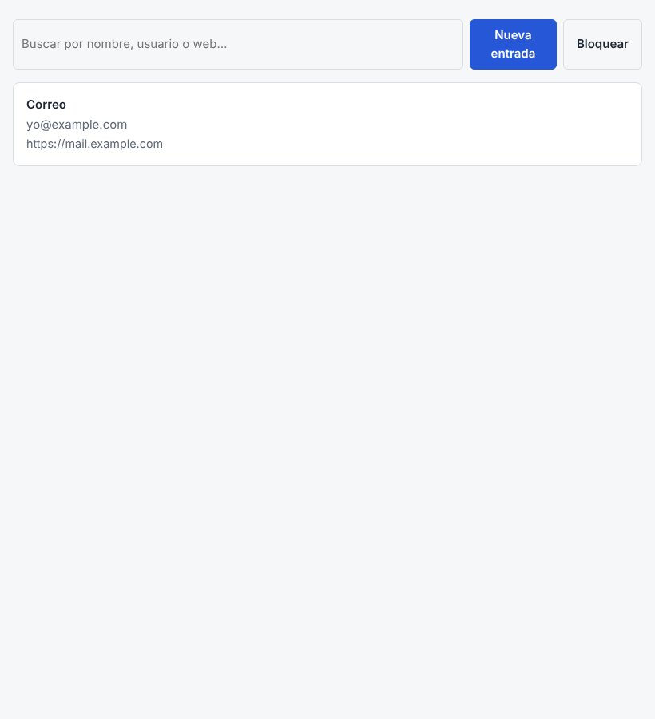
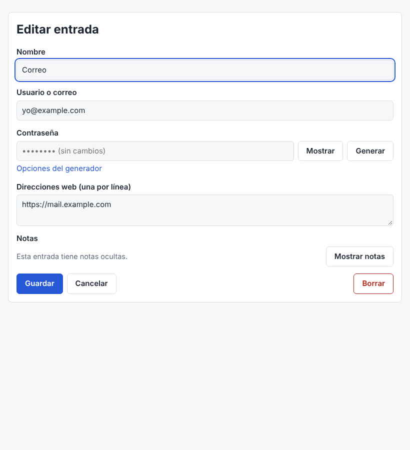
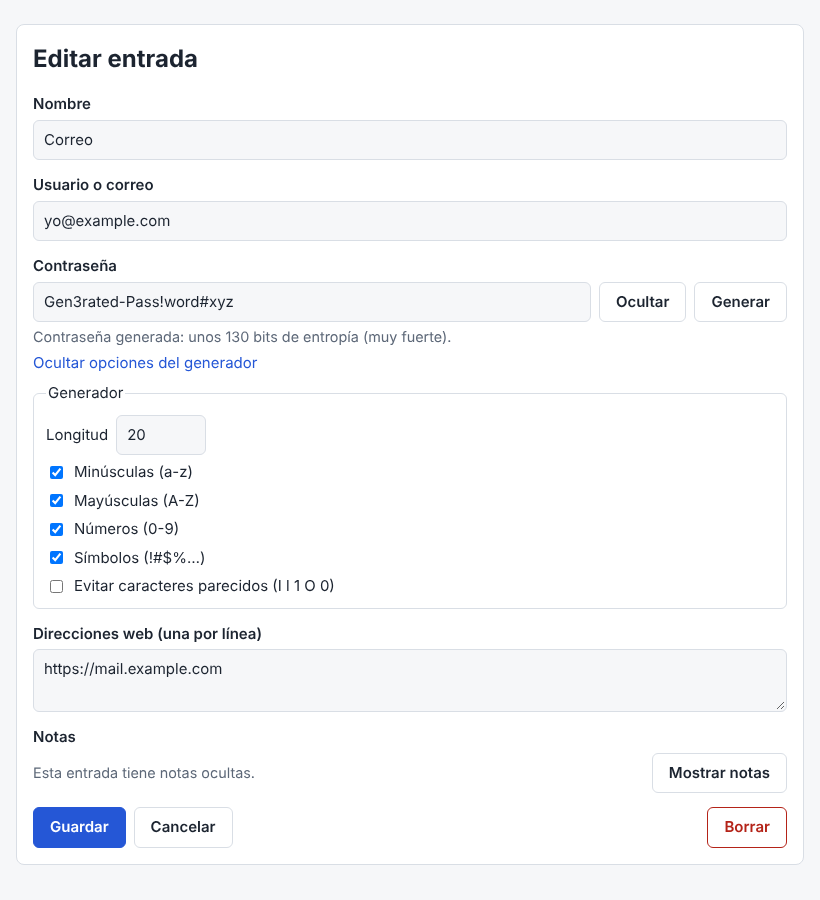

# 0010 — Formulario de entradas y generador en la app

- **Fecha:** 2026-11-25
- **Fase:** 1
- **Commits:** commit «app: entry form (add, edit, delete) with password generator» (PR hacia `main`)

## Resumen
Ya se pueden **añadir, editar y borrar entradas desde la app**, con el **generador de contraseñas** integrado en el formulario. Cada cambio se guarda en el archivo cifrado en el momento. Las contraseñas y las notas solo se envían a la interfaz cuando el usuario pulsa «Mostrar» o «Generar».

| Lista | Editar entrada | Contraseña generada |
|---|---|---|
|  |  |  |

*Capturas de la interfaz compilada en un navegador (Chromium) con el backend de Tauri simulado y datos de prueba.*

## Cambios

**Rust (`app/src/`)**
- **`state.rs`:** nueva lógica para el formulario, separada de Tauri para poder probarla.
  - `get`: devuelve nombre, usuario y URLs de una entrada, más dos indicadores (`hasPassword`, `hasNotes`). **Nunca la contraseña ni las notas.**
  - `reveal`: devuelve la contraseña o las notas de una entrada. La interfaz solo la usa cuando el usuario pulsa «Mostrar».
  - `add`, `update`, `delete`: modifican el llavero y **lo guardan en el acto** (guardado atómico con `.bak`, como siempre).
  - **Si el cambio o el guardado fallan, se deshace en memoria**, para que lo que se ve en la app coincida siempre con lo que hay en el archivo.
  - Al editar, si el usuario no ha tocado la contraseña o las notas, **se conservan las guardadas**. También se conservan los campos de auto-type (ventanas y secuencia), que el formulario aún no muestra.
  - Se quitan los espacios sobrantes del nombre, del usuario y de las URLs, y se descartan las líneas de URL vacías.
  - `generate_password`: llama a `core::generator` y devuelve la contraseña y su entropía aproximada en bits. Siempre exige al menos un carácter de cada tipo elegido.
  - **Errores nuevos (solo códigos):** `EmptyName`, `EntryNotFound` e `InvalidGeneratorOptions`. Los errores del modelo ya no se convierten en `Internal`.
- **`commands.rs`:** seis comandos nuevos: `get_entry`, `reveal_secret`, `add_entry`, `update_entry`, `delete_entry` y `generate_password`.
- **`build.rs` + `capabilities/main.json`:** los seis comandos se han añadido al manifiesto y concedido de forma explícita a la ventana principal. No se ha añadido ningún plugin ni se ha tocado la CSP.

**Interfaz (`app/ui/`)**
- **`EntryForm.svelte` (nuevo):** formulario para crear y editar con estos campos: nombre, usuario, contraseña, direcciones web (una por línea) y notas.
  - **Contraseña:**
    - Al editar, el campo aparece vacío con el texto «(sin cambios)».
    - «Mostrar» pide la contraseña al backend solo en ese momento.
    - «Generar» rellena el campo con una contraseña nueva y muestra su fuerza (bits de entropía).
  - **Opciones del generador** (plegables): longitud (8–256), minúsculas, mayúsculas, números, símbolos y evitar caracteres parecidos. Por defecto: 20 caracteres de todos los tipos, unos 130 bits.
  - **Notas:** si la entrada tiene notas, se muestra «Esta entrada tiene notas ocultas» con un botón «Mostrar notas».
  - **Borrar:** pide confirmación en dos pasos («Borrar» → «Sí, borrar»).
  - Al cerrar el formulario se vacían las variables con secretos (en la medida en que el navegador lo permite).
- **`VaultView.svelte`:** botón «Nueva entrada». Al pulsar una entrada de la lista se abre su formulario.
- **`api.ts`:** funciones con tipos para los comandos nuevos y mensajes en español para los errores nuevos.
- **`app.css`:** estilos de los campos de texto, botones de peligro y opciones del generador. Además, el texto escrito en los campos ya no aparece en negrita.

**Dependencias:** ninguna nueva, ni de Rust ni de npm.

## Decisiones
- **Contraseñas y notas, solo bajo petición.** Así lo exige `CLAUDE.md`: el formulario de edición no las recibe al abrirse. Si el usuario no las toca, la interfaz envía `null` y el backend conserva lo guardado.
  - Consecuencia: para vaciar la contraseña de una entrada existente, primero hay que mostrarla y después borrarla. Es poco habitual y evita tener que enviarla a la interfaz.
- **Guardado inmediato** en cada alta, edición o borrado, sin botón «Guardar llavero». Así, si la app se cierra de golpe, no se pierden cambios.
- **El generador se ejecuta en Rust** (`core::generator`, con el generador aleatorio del sistema) y no en JavaScript, para usar el código ya probado y una sola fuente de aleatoriedad.
- **La entrada se identifica con el id en texto** que la interfaz ya recibe en la lista. Así no hace falta añadir el crate `uuid` a la app.

## Verificación
- `cargo fmt --all --check`: correcto.
- `cargo clippy --workspace --all-targets -- -D warnings`: sin avisos.
- `cargo test --workspace`: todo en verde. La app pasa de 6 a 15 tests. Los nuevos cubren:
  - Ciclo completo de alta, consulta, edición y borrado, comprobando que cada cambio llega al disco (bloquear y volver a abrir).
  - Los secretos sin tocar se conservan, los tocados se sustituyen y las notas se pueden vaciar.
  - Los campos de auto-type se conservan al editar.
  - Rechazo de nombre vacío y de ids inexistentes, sin modificar nada.
  - **Si el guardado falla, la memoria vuelve al estado anterior** (prueba que borra la carpeta del llavero antes de guardar).
  - Todos los comandos de entradas exigen el llavero abierto.
  - La respuesta de `get_entry` nunca contiene la contraseña ni las notas.
  - Formato JSON del formulario, incluido el rechazo de campos desconocidos.
  - Generador: longitud, entropía, formato JSON y opciones no válidas.
- `npm ci`, `npm audit --audit-level=low` (0 vulnerabilidades), `npm run check` (0 errores, 0 avisos) y `npm run build`: correctos.
- **Prueba de la interfaz** en Chromium con Playwright y el backend simulado. Se ha recorrido abrir una entrada, generar contraseña, guardar, crear otra entrada y borrarla, sin errores en la consola. Se ha comprobado que:
  - No se llama a `reveal_secret` sin pulsar «Mostrar».
  - Las notas sin tocar se envían como `null`.
- `cargo deny` no está instalado en el entorno de desarrollo usado; lo ejecuta la CI. No hay dependencias nuevas.

## Pendiente / siguientes pasos
- **Copiar el usuario o la contraseña** al portapapeles, con limpieza automática (trait de portapapeles en `platform/`).
- **Bloqueo automático** por inactividad y al bloquear la sesión de Windows.
- Campos de auto-type (ventanas y secuencia) en el formulario: Fase 2.
- Alerta de Dependabot sobre `glib` 0.18 (GHSA-wrw7-89jp-8q8g): solo afecta a la compilación para Linux a través de Tauri. Ya está justificada en `deny.toml`. El responsable del proyecto la descartará en GitHub como riesgo tolerable, y hay que revisarla antes del port a Linux (Fase 4).
