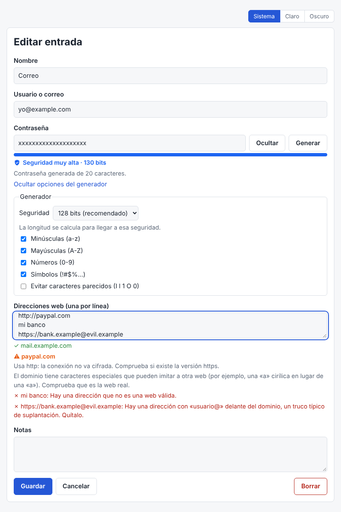
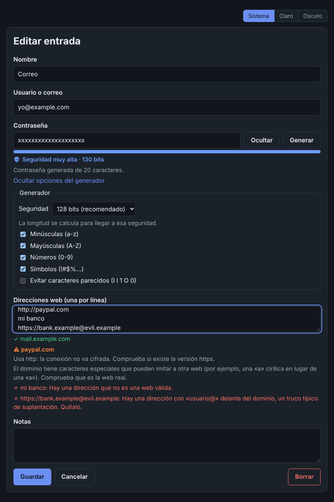

# 0011 — Modo oscuro, generador por entropía, barra de seguridad, borrado con contraseña y comprobación de webs

- **Fecha:** 2026-11-25
- **Fase:** 1
- **Commits:** commit «app: dark mode, entropy targets, strength bar, password-confirmed delete, offline URL checks» (PR hacia `main`)

## Resumen
Mejoras pedidas por el responsable del proyecto tras probar la app:
- Selector de tema: claro, oscuro o el del sistema.
- Generador por objetivo de entropía (64, 128 o 256 bits). Por defecto, 128 bits.
- Barra de seguridad de color: de rojo a verde, y azul con un escudo cuando la seguridad es muy alta.
- Para borrar una entrada hay que escribir la contraseña maestra.
- Comprobación sin conexión de las direcciones web.

Lo que no tiene sentido hacer ahora se ha añadido a la hoja de ruta (ver «Pendiente»).

| Formulario (claro) | Formulario (oscuro) | Borrar con contraseña |
|---|---|---|
|  |  |  |

Barra con seguridad media (64 bits): 

*Capturas de la interfaz compilada en Chromium con la misma CSP que la app en producción, el backend de Tauri simulado y datos de prueba.*

## Cambios

**`core` (con tests)**
- **`generator::length_for_entropy`:** calcula la longitud mínima que alcanza un número de bits con los tipos de carácter elegidos.
  - Si se exige un carácter de cada tipo, pide 1 bit de margen, porque esa regla reduce un poco la entropía real. Así la contraseña nunca se queda por debajo del objetivo.
  - Si el objetivo no se puede alcanzar con la longitud máxima (256), devuelve un error en lugar de una contraseña más corta.
  - Con los cuatro tipos de carácter: 64 bits → 11 caracteres, 128 → 20, 256 → 40.
  - Nueva constante `DEFAULT_TARGET_BITS = 128`.
- **`Vault::verify_password`:** comprueba una contraseña contra el archivo del disco con la derivación Argon2 completa. Es tan lenta como abrir el llavero, así que no facilita los ataques por fuerza bruta.
- **`web` (módulo nuevo): `check_web_address`**, sin ninguna conexión de red.
  - **Normaliza** la dirección: minúsculas, `https://` si falta y dominios internacionales en formato `xn--`.
  - **Rechaza:**
    - Textos que no son una web (con espacios, extensión final inválida, etc.).
    - Esquemas distintos de http/https (`javascript:`, `file:`, `data:`, `ftp:`…).
    - Direcciones con `usuario@` delante del dominio (`https://banco.example@malo.example`), un truco típico de suplantación.
  - **Avisa, sin bloquear el guardado, de:**
    - `http` sin cifrar.
    - Direcciones IP.
    - Dominios con caracteres que pueden imitar a otra web (`xn--`, por ejemplo una «а» cirílica en lugar de una «a»).
    - Nombres sin dominio (`intranet`).
    - Nombres de programa (`notepad.exe`).
  - **Usa el crate `url`** (estándar WHATWG), sin análisis escrito a mano. Ya estaba en el árbol de dependencias a través de Tauri, con licencias ya aprobadas. Se añade al `core` porque la coincidencia exacta de dominio de la Fase 3 también lo necesitará.

**App (`app/src/`)**
- `generate_password` acepta `targetBits` y devuelve también la longitud usada.
- `delete_entry` exige la contraseña maestra.
  - Es un comando `async`, porque ejecuta Argon2.
  - Si la contraseña es incorrecta, no se borra nada.
- `add_entry` y `update_entry` comprueban y normalizan las direcciones web, y quitan las duplicadas. Una dirección inválida impide guardar, con un código de error concreto (`NotAWebAddress`, `UnsupportedScheme` o `EmbeddedCredentials`).
- Comando nuevo `check_url`, para avisar mientras se escribe. Está declarado en `build.rs` y concedido en `capabilities/main.json`.

**Interfaz (`app/ui/`)**
- **Modo oscuro:**
  - Selector «Sistema / Claro / Oscuro» arriba a la derecha.
  - La elección se guarda en el almacenamiento local de la ventana. Es una preferencia de visualización, nunca un secreto.
  - Se aplica antes de pintar la página, para que no haya un parpadeo con el tema equivocado.
- **Generador:**
  - Selector «Seguridad» con 64 bits, 128 bits (recomendado, el valor por defecto) o 256 bits, o bien «Longitud fija».
  - Muestra cuántos caracteres ha generado.
- **Barra de seguridad (`StrengthMeter.svelte`):** se llena hasta 128 bits.

  | Bits | Nivel | Color |
  |---|---|---|
  | Menos de 40 | Muy baja | rojo |
  | 40 a 59 | Baja | naranja |
  | 60 a 79 | Media | ámbar |
  | 80 a 99 | Buena | verde claro |
  | 100 a 127 | Alta | verde |
  | 128 o más | Muy alta | azul, con escudo |

  - Es una barra `<progress>` con colores por clase, sin estilos en línea, así que funciona con la CSP estricta.
- **Borrar:** abre un cuadro con aviso en rojo que pide la contraseña maestra. El botón «Borrar definitivamente» está desactivado hasta que se escribe algo, y el campo se vacía después de cada intento.
- **Direcciones web:** debajo del campo se muestra, para cada línea:
  - ✓ y el dominio, si todo está bien.
  - ⚠ y los avisos, si hay riesgos.
  - ✗ y el motivo, si no es válida.

## Decisiones
- **«Bits múltiplos de 2» = potencias de 2.** Confirmado por el responsable del proyecto: por defecto 128 bits, y opciones de 64, 128 y 256. La entropía real nunca sale exacta (20 caracteres dan unos 131 bits), así que se garantiza llegar al menos al objetivo.
- **Comprobación de webs sin conexión.** Confirmado por el responsable del proyecto: la app no se conecta a internet, una regla del proyecto que evita revelar a terceros qué webs se guardan. Por eso no puede saber si una web existe o es fraudulenta; solo detecta direcciones mal formadas y trucos conocidos.
- **Los dominios internacionales legítimos** (por ejemplo `españa.es`) también reciben el aviso de caracteres especiales. Es un aviso y no un bloqueo: la app no puede distinguirlos de una imitación sin una lista externa.
- **La barra solo aparece con contraseñas generadas**, cuya entropía se conoce exactamente. Para contraseñas escritas a mano, contar caracteres sobrestimaría mucho la seguridad de algo como `Password123!`. Un estimador fiable (tipo zxcvbn) queda para más adelante.
- **El tema solo cambia el contenido.** La barra de título de Windows sigue el tema del sistema: cambiarla requeriría un permiso de ventana adicional en Tauri, y las instrucciones piden no ampliar permisos sin preguntar.

## Verificación
- `cargo fmt --all --check` y `cargo clippy --workspace --all-targets -- -D warnings`: correctos.
- `cargo test --workspace`: todo en verde. El `core` pasa de 62 a 73 tests y la app de 15 a 18. Los nuevos cubren:
  - **Longitud por entropía:** valores conocidos, que siempre se alcanza el objetivo, que la longitud es la mínima posible y los límites.
  - **`verify_password`:** contraseña correcta, incorrecta y vacía.
  - **Direcciones web:**
    - Normalización.
    - Rechazos: textos que no son web, esquemas y credenciales.
    - Avisos, incluido un dominio con una «а» cirílica.
  - **Borrado con contraseña:** con una contraseña incorrecta no se borra nada.
  - **Formulario con una dirección inválida:** no se guarda nada.
- `cargo deny --locked check`: correcto. `npm ci`, `npm audit --audit-level=low` (0 vulnerabilidades), `npm run check` (0 errores, 0 avisos) y `npm run build`: correctos.
- **Prueba de la interfaz** en Chromium con Playwright, la **CSP de producción** y el backend simulado, en tema claro y oscuro. Se ha recorrido generar con 64 y 128 bits, comprobar direcciones, borrar con contraseña incorrecta y luego correcta, y forzar el tema y recargar. Sin errores de consola ni bloqueos de la CSP. La preferencia de tema se mantiene tras recargar.

## Pendiente / siguientes pasos
Añadido a la hoja de ruta del README:
- **Fase 2:** comprobar los programas asociados a una entrada (que el ejecutable exista y, si es posible, su firma digital), con un trait en `platform/`.
- **Fase 3:** lista pública de sufijos (Public Suffix List) incluida en la app, para reconocer el dominio real (`banco.example.co.uk`) y avisar de dominios que no existen.
- **Fase 4:** medidor de fuerza para contraseñas escritas a mano (estimador tipo zxcvbn), junto con la auditoría de contraseñas débiles.

Siguen pendientes en la Fase 1 la copia al portapapeles con limpieza automática y el bloqueo automático.
