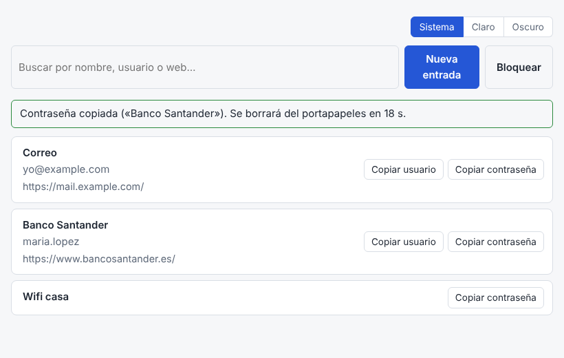

# 0012 — Copiar usuario y contraseña al portapapeles con borrado automático

- **Fecha:** 2026-11-25
- **Fase:** 1
- **Commits:** commit «Copy user name and password to the clipboard with automatic clearing» (PR hacia `main`)

## Resumen
Cada entrada de la lista tiene ahora los botones **«Copiar usuario»** y **«Copiar contraseña»**.
- **La copia se hace en Rust:** la contraseña nunca llega a la interfaz.
- **En Windows**, lo copiado queda **fuera del historial del portapapeles (Win+V) y de la sincronización en la nube**.
- **Se borra solo a los 20 segundos**, y también al bloquear el llavero o cerrar la app. Nunca se borra algo que el usuario haya copiado después.

*Captura de la interfaz compilada en Chromium con la CSP de producción, el backend simulado y datos de prueba.*

## Cambios

**`platform/` (primer trait real del crate)**
- **`clipboard.rs`:**
  - Trait `Clipboard`, con tres operaciones: `set_secret`, `get_text` y `clear`.
  - Error `ClipboardError`, que nunca incluye el contenido.
  - Función `clear_if_unchanged`: solo borra el portapapeles si todavía contiene lo que copió la app.
  - Implementación `SystemClipboard` sobre el crate `arboard`. Mantiene la conexión con el portapapeles abierta, porque en Linux (X11) el texto desaparecería al cerrarla.
- **Una implementación por sistema** (`windows.rs`, `linux.rs`, `macos.rs`), seleccionada con `#[cfg(target_os)]`:
  - **Windows:** marca el contenido con `ExcludeClipboardContentFromMonitorProcessing`. Windows lo deja fuera del historial (Win+V) y del portapapeles en la nube, y pide a otros programas que vigilan el portapapeles que lo ignoren.
  - **Linux:** usa la marca `x-kde-passwordManagerHint`, que respetan los gestores de portapapeles compatibles.
  - **macOS:** marca el contenido como oculto (convención de nspasteboard.org).
  - Linux y macOS son implementaciones básicas; el port completo es de la Fase 4.

**App (`app/src/`)**
- **`AppState::copy`:** lee el usuario o la contraseña del llavero abierto y lo copia.
  - Guarda una copia del valor en un tipo que se borra de memoria al liberarse (`Zeroizing`).
  - Programa el borrado a los **20 s** (constante `CLIPBOARD_CLEAR_SECONDS`).
- **Cada copia lleva un número de orden.** Un temporizador solo borra la copia que lo creó, así que si copias otra cosa antes, el temporizador anterior no la toca.
- **Borrado inmediato:**
  - Al **bloquear** (`lock`).
  - Al **cerrar la app** (evento `Exit` de Tauri, en `main.rs`).
- **Comando nuevo `copy_to_clipboard`**:
  - Es `async`.
  - Devuelve los segundos que faltan para el borrado, nunca el valor copiado.
  - Está declarado en `build.rs` y concedido en `capabilities/main.json`.
- **Errores nuevos (solo códigos):** `ClipboardUnavailable` y `NothingToCopy`, este último si la entrada no tiene usuario o contraseña.
- `llavero-platform` vuelve a ser dependencia de la app, ahora que se usa.

**Interfaz (`app/ui/`)**
- **Lista:** cada entrada tiene «Copiar usuario» (solo si la entrada tiene usuario) y «Copiar contraseña». Pulsar el resto de la entrada sigue abriendo el formulario.
- **Aviso con cuenta atrás:** por ejemplo, «Contraseña copiada («Banco Santander»). Se borrará del portapapeles en 18 s.».
- El botón «Nueva entrada» ya no se parte en dos líneas.

**Dependencias**
- **`arboard` 3** (sin las funciones por defecto, así que sin soporte de imágenes). Es MIT o Apache-2.0.
- **Lo que trae en Windows:** `clipboard-win` y `error-code`, con licencia **BSL-1.0** (Boost).
  - Es una licencia **nueva** para el proyecto. Se ha añadido **de forma explícita** a `deny.toml`.
  - Es una licencia permisiva, equivalente a MIT. Se ha comprobado que sin esa línea `cargo deny` rechaza la compilación.
- **Lo que trae en Linux:** `x11rb` y crates auxiliares, todos MIT o Apache-2.0.

## Decisiones
- **20 segundos** de borrado, dentro del rango de 15–30 s de los requisitos. Más adelante puede hacerse configurable.
- **`arboard` en lugar de llamar a mano a la API de Windows.** Llamarla directamente exigiría código `unsafe`, que el proyecto prohíbe (`unsafe_code = "deny"`). `arboard` es el crate de portapapeles más usado en Rust y ya expone las marcas de exclusión de Windows.
- **No se usa el plugin de portapapeles de Tauri:** las instrucciones piden no añadir plugins. Además, ese plugin daría acceso al portapapeles a la propia página web, y así la interfaz no puede ni leerlo ni escribirlo.
- **Solo se borra si el contenido sigue siendo el copiado.** Para saberlo, la app lee el portapapeles en ese momento.
- **Limitación:** si otro programa lee el portapapeles mientras la contraseña está ahí (por ejemplo, un malware), puede verla. Ningún gestor de contraseñas puede impedirlo; por eso el tiempo es corto.

## Verificación
- `cargo fmt --all --check` y `cargo clippy --workspace --all-targets -- -D warnings`: correctos. También se ha ejecutado `clippy` de `core` y `platform` **compilando para Windows** (`x86_64-pc-windows-msvc`), sin avisos.
- `cargo test --workspace`: todo en verde. La app pasa de 19 a 24 tests y `platform` de 1 a 2. Los nuevos cubren, con un portapapeles simulado:
  - Copiar y borrar al cumplirse el plazo.
  - Una copia nueva no la borra el temporizador anterior.
  - Lo que copia el usuario después nunca se borra.
  - Al bloquear se borra en el acto.
  - Errores: entrada sin contraseña, entrada inexistente y llavero bloqueado.
- `cargo deny --locked check`: correcto (con BSL-1.0 permitida).
- `npm run check` (0 avisos), `npm run build` y `npm audit --audit-level=low` (0 vulnerabilidades): correctos.
- **Prueba de la interfaz** en Chromium con Playwright y la CSP de producción, en tema claro y oscuro y con ventana ancha y estrecha:
  - Al copiar se llama al comando con el campo correcto.
  - El aviso cuenta atrás.
  - Las entradas sin usuario no muestran «Copiar usuario».
  - No hay errores en la consola.
- **Prueba manual en Windows: correcta.** El responsable del proyecto lo comprobó el 2026-11-25 con la app real (ver el informe 0014):
  1. La contraseña copiada se pega en el Bloc de notas.
  2. No aparece en el historial de Win+V.
  3. A los 20 s ya no se puede pegar.
  4. Al bloquear el llavero, el portapapeles se vacía.

## Pendiente / siguientes pasos
- **Bloqueo automático** por inactividad y al bloquear la sesión de Windows: siguiente PR, con el que se cierra la Fase 1.
- Tiempo de borrado configurable, junto con un futuro menú de ajustes.
