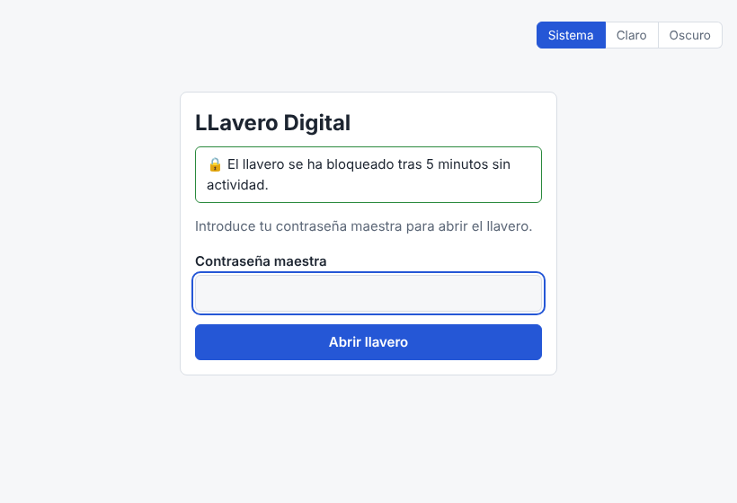
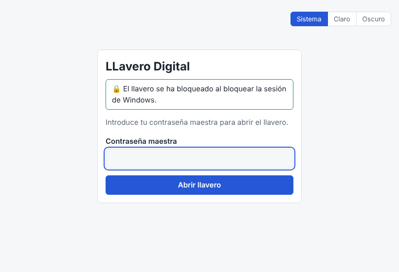

# 0013 — Bloqueo automático por inactividad y al bloquear la sesión de Windows (cierre de la Fase 1)

- **Fecha:** 2026-11-25
- **Fase:** 1
- **Commits:** commit «Auto-lock on inactivity and when the Windows session locks» (PR hacia `main`)

## Resumen
El llavero se bloquea solo en dos casos:
- **Tras 5 minutos sin actividad.**
- **En cuanto se bloquea la sesión de Windows** (Win+L, suspensión con bloqueo, etc.).

Al bloquearse, la clave y los secretos se borran de la memoria y se limpia el portapapeles. La pantalla de desbloqueo explica por qué se ha bloqueado.

**Con esto queda terminada la Fase 1 (MVP).**

| Bloqueo por inactividad | Bloqueo al bloquear Windows |
|---|---|
|  |  |

*Capturas de la interfaz compilada en Chromium con la CSP de producción y el backend simulado.*

## Cambios

**`platform/`**
- **`session.rs`:** función `is_session_locked()`.
  - Devuelve `Some(true)` o `Some(false)`, o `None` si no se puede saber.
  - En ese caso, la app sigue protegida por el bloqueo por inactividad.
- **`windows.rs`:** implementación con `WTSQuerySessionInformationW(WTSSessionInfoEx)`, la forma documentada de preguntar a Windows 10/11 si la sesión está bloqueada. Usa `windows-sys`, que ya estaba en el proyecto; solo se añaden dos funciones de esa librería.
- **`linux.rs` / `macos.rs`:** devuelven `None` por ahora (port en la Fase 4).

**App (`app/src/`)**
- **`AppState`:**
  - Guarda el momento de la última actividad (`touch`).
  - `auto_lock(ahora, sesión_bloqueada)` bloquea si la sesión está bloqueada o si han pasado `IDLE_TIMEOUT` = 5 minutos. Bloquear también limpia el portapapeles (informe 0012).
  - Cuentan como actividad abrir el llavero y cualquier acción sobre las entradas: listar o buscar, ver, mostrar, añadir, editar, borrar y copiar.
- **Vigilante en `main.rs`:** cada 2 segundos comprueba el estado de la sesión de Windows y la inactividad. Está en el backend, así que bloquea aunque la ventana esté minimizada, oculta o colgada.
- **`vault_status`** devuelve además `lockReason` (`inactivity` o `sessionLocked`) cuando el bloqueo ha sido automático. Se borra al bloquear a mano o al volver a abrir el llavero.
- **Comando nuevo `user_activity`:** declarado en `build.rs` y concedido en `capabilities/main.json`.

**Interfaz (`app/ui/`)**
- **Actividad:** teclas, clics, movimiento del ratón y rueda dentro de la ventana avisan al backend, **como máximo una vez cada 15 s**.
- **Comprobación del estado:** mientras el llavero está abierto, la interfaz pregunta cada 2 s si sigue abierto. Esa consulta no cuenta como actividad. Si el backend lo ha bloqueado, cambia en el acto a la pantalla de desbloqueo.
  - Si había un formulario a medio editar, se descarta y sus secretos se vacían. Es intencionado: el bloqueo tiene prioridad.
- **Pantalla de desbloqueo:** muestra «🔒 El llavero se ha bloqueado tras 5 minutos sin actividad.» o «…al bloquear la sesión de Windows.».

**Reglas del proyecto (`CLAUDE.md`)**
- Se documenta la **única excepción a la prohibición de `unsafe`**. Cualquier excepción nueva necesita la aprobación del responsable.

## Decisiones
- **Excepción `unsafe` mínima, aprobada por el responsable del proyecto.** Saber si la sesión de Windows está bloqueada solo es posible con la API en C de Windows, y no existe ningún crate seguro y mantenido que lo haga. Se descartaron dos alternativas:
  - **Plugins de Tauri de terceros:** poco usados y sin auditar.
  - **Depender solo de la inactividad:** el llavero quedaría abierto hasta 5 minutos tras pulsar Win+L.

  **Cómo se acota:**
  - Una sola función de unas 30 líneas, con `#[allow(unsafe_code)]` solo en ella. El lint `unsafe_code = "deny"` sigue activo en todo lo demás.
  - Un comentario `SAFETY` en cada bloque.
  - Se comprueba el tamaño del búfer antes de leerlo, se lee sin suponer alineación y la memoria se libera una sola vez.
  - Si algo falla, devuelve «desconocido»; nunca hace fallar la app.
- **Consulta cada 2 s en lugar de suscribirse a avisos de Windows.** Suscribirse exigiría una ventana oculta y bastante más código `unsafe`. El coste de la consulta es despreciable, y el bloqueo llega como mucho 2 segundos tarde.
- **5 minutos de inactividad**, elegidos por el responsable del proyecto. Se podrá cambiar desde un futuro menú de ajustes.
- **Comprobación del estado desde la interfaz cada 2 s, en lugar de eventos de Tauri.** Los eventos exigirían conceder permisos de eventos del núcleo de Tauri, y las instrucciones piden no ampliar permisos sin preguntar.

## Verificación
- `cargo fmt --all --check` y `cargo clippy --workspace --all-targets -- -D warnings`: correctos.
- `clippy` de `core` y `platform` compilando para Windows (`x86_64-pc-windows-msvc`), donde está el código `unsafe`: sin avisos.
- `cargo test --workspace`: todo en verde. La app pasa de 24 a 28 tests y `platform` de 2 a 3. Los nuevos cubren:
  - Bloqueo al pasar el plazo, pero no antes.
  - La actividad pospone el bloqueo, y usar el llavero cuenta como actividad.
  - Bloqueo inmediato si la sesión está bloqueada, que además limpia el portapapeles.
  - El motivo se guarda, se borra al reabrir y no aparece en un bloqueo manual.
  - La consulta de sesión no falla nunca. En la CI de Windows llama de verdad a la API de Windows.
- `cargo deny --locked check`, `npm ci`, `npm audit --audit-level=low` (0 vulnerabilidades), `npm run check` (0 avisos) y `npm run build`: correctos.
- Se ha comprobado que no hay ningún otro `unsafe` en el código.
- **Prueba de la interfaz** (Playwright, CSP de producción):
  - Treinta interacciones seguidas generan un solo aviso de actividad.
  - Cuando el backend bloquea, la pantalla cambia en menos de 2 s y muestra el motivo correcto en los dos casos.
  - Sin errores en la consola.
- **Pendiente de probar a mano en Windows:**
  1. Abrir el llavero y pulsar Win+L.
  2. Al volver, debe estar bloqueado y decir «al bloquear la sesión de Windows».
  3. Dejarlo abierto 5 minutos sin tocarlo: debe bloquearse.

## Pendiente / siguientes pasos
- **Fase 1 terminada.** Siguiente: **Fase 2 (auto-type en programas)**: traits de plataforma para el atajo global, la ventana activa y la escritura simulada, con su implementación para Windows.
- Menú de ajustes con el tiempo de inactividad, el tiempo de borrado del portapapeles y el tema.
